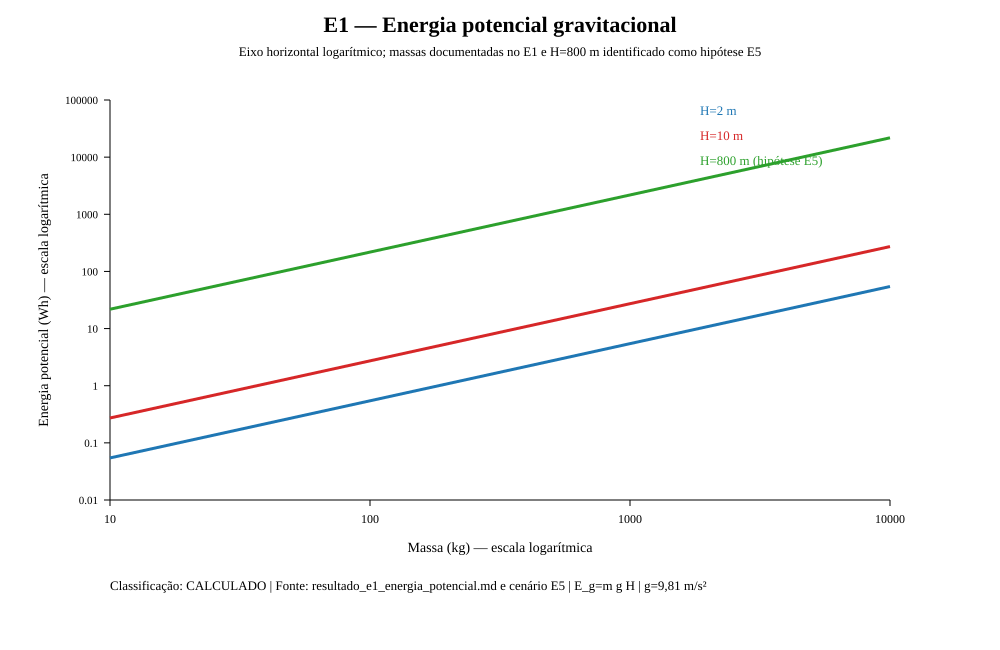
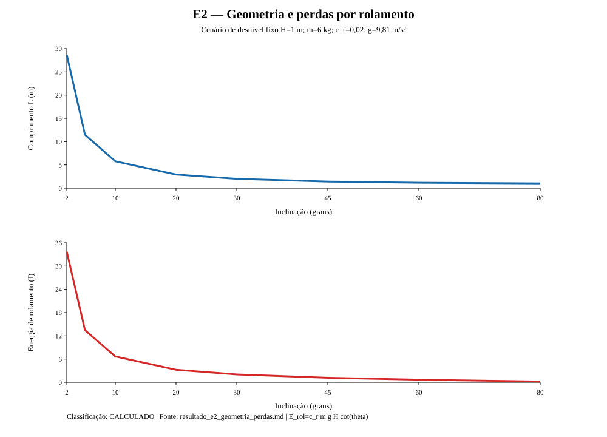
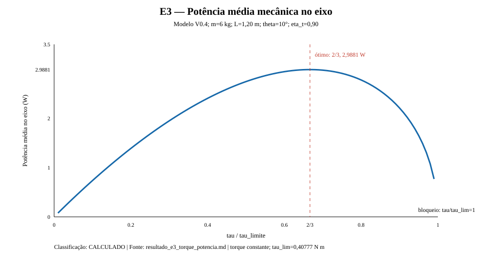
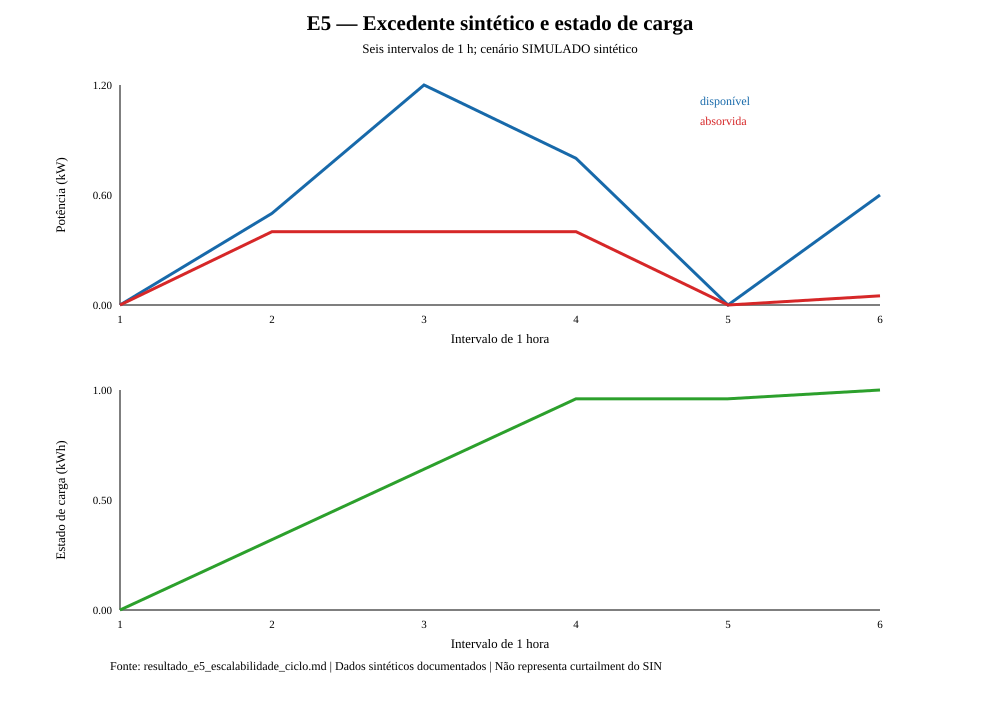

# GravBat

**Armazenamento gravitacional em plano inclinado | TCC II, Engenharia de Energia, UFSC**

O GravBat começou com uma pergunta que surgiu no TCC I: o que muda quando, em vez de descer verticalmente, uma massa percorre um plano inclinado para acionar um sistema de geração elétrica?

A energia potencial disponível continua sendo determinada pela massa e pelo desnível. O que muda é o percurso, a força ao longo do trilho, a velocidade e a forma de transmitir o movimento ao gerador. No TCC II, estou estudando essas relações por meio de cálculos e simulações em Python, antes de considerar uma montagem física.

O projeto ainda é computacional. Os números apresentados aqui são resultados dos modelos ou hipóteses de dimensionamento, não medições de um protótipo.

## O que foi desenvolvido

Organizei o estudo em cinco experimentos, cada um voltado a uma parte do problema:

### E1 | Quanta energia uma massa armazena?

A referência é a energia potencial gravitacional:

$$
E_g = mgH
$$

Uma massa de **1.000 kg** a **2 m** de altura possui **19.620 J (5,45 Wh)** de energia potencial ideal. Com **800 m** de desnível, o valor sobe para **2,18 kWh**. Esses valores não incluem perdas na recuperação.



### E2 | O que a inclinação muda?

Para alcançar o mesmo desnível, uma rampa menos inclinada precisa ser mais longa. Com **1 m** de altura, por exemplo, o percurso é de aproximadamente **28,65 m a 2°**, contra **2,00 m a 30°**.

O modelo também considera resistência ao rolamento. Com coeficiente de **0,02**, o equilíbrio entre a componente gravitacional ao longo da rampa e essa resistência ocorre em aproximadamente **1,146°**. É uma condição do modelo adotado, não um limite universal para sistemas sobre trilhos.



### E3 | Quanto torque retirar da descida?

O torque resistente interfere tanto na aceleração quanto no tempo de movimento. No modelo simplificado de torque constante, a maior potência mecânica média aparece quando o torque corresponde a **2/3 do valor-limite**. Para o caso estudado, isso resultou em cerca de **2,99 W no eixo**.

Esse ponto é específico do modelo E3. Não significa que o mesmo ajuste maximize a energia elétrica entregue por um gerador real.



### E4 | O que chega à carga elétrica?

Nesta etapa, a simulação passa a incluir um modelo eletromecânico equivalente, com força eletromotriz, resistência dos enrolamentos e carga resistiva. No caso de **8 Ω**, o modelo calculou **0,4766 J na carga AC** e **0,1192 J dissipados no cobre**.

A análise também acompanha a energia cinética que permanece na massa ao fim da descida. Ainda não há gerador físico caracterizado nem controle ativo por PWM ou encoder. A figura temporal consolidada do E4 está pendente.

### E5 | Como os resultados mudam de escala?

O último experimento considera módulos e ciclos de carga e descarga em cenários hipotéticos. **Dez massas de 1.000 kg**, cada uma com **800 m** de desnível, somam **21,8 kWh** de energia potencial ideal. Adotando **55% de rendimento de descarga como hipótese**, a saída estimada seria **11,99 kWh**.

Também foi testada uma série sintética de excedente energético para visualizar o deslocamento da energia no tempo. Isso não representa uma avaliação da operação real do Sistema Interligado Nacional.



## Como explorar o projeto

O código está dividido em `model/` (equações), `simulation/` (simulações), `dashboard/` (interface e gráficos) e `tests/` (testes automatizados). Os relatórios dos experimentos e os documentos de apoio ao TCC estão em `docs/tcc/`.

Para executar no Windows, abra o PowerShell na raiz do projeto e crie o ambiente Python:

```powershell
python -m venv .venv
.\.venv\Scripts\python.exe -m pip install -r requirements.txt
```

Inicie o dashboard:

```powershell
.\.venv\Scripts\python.exe -B -m streamlit run app.py --server.address 127.0.0.1 --server.port 8501
```

A interface ficará disponível em **http://127.0.0.1:8501**.

Para executar os testes:

```powershell
.\.venv\Scripts\python.exe -B -m unittest discover -s tests -v
```


## Em que ponto está a pesquisa?

Os modelos permitem comparar energia potencial, geometria, perdas, torque, potência mecânica e comportamento de uma carga elétrica equivalente. **Ainda não permitem afirmar a eficiência de um equipamento construído**, nem sua viabilidade estrutural ou econômica.

A comparação entre os arranjos vertical e inclinado continua sendo uma parte central do trabalho. Para a mesma massa e o mesmo desnível, a energia potencial ideal é igual; o interesse está em entender como cada configuração altera o movimento, as perdas e as exigências de transmissão.

A próxima etapa é discutir com o orientador quais análises precisam ser aprofundadas e se o escopo computacional é suficiente para a conclusão do TCC II.

**Para acompanhar os resultados:** [apresentação ao orientador](docs/APRESENTACAO_ORIENTADOR.md) e relatórios E1–E5 em `docs/tcc/`.
